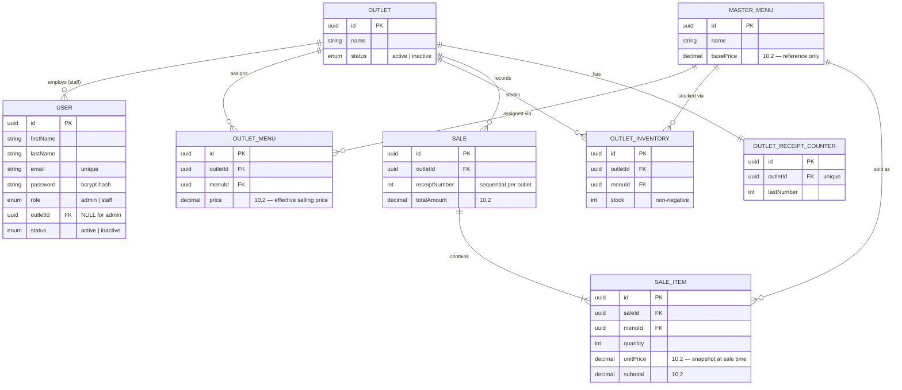

# Architecture Documentation

Multi-Outlet F&B Management System. Companion to the [backend
README](../README.md) (setup, API reference) and the [frontend
README](https://github.com/shahadath-evenly/fb-management-frontend/blob/main/README.md).

Contents:

1. [ERD](#erd)
2. [Scaling plan — 10 outlets, 100,000 transactions/month](#scaling-plan)
3. [Conversion to microservices](#microservices)
4. [Offline POS mode strategy](#offline-pos)

---

## 1. ERD

**Constraints not visible in the diagram shape itself:**

- `User.email` — unique.
- `OutletMenu(outletId, menuId)` — unique. An item can only be assigned
  to an outlet once; re-assigning updates the existing row's price.
- `OutletInventory(outletId, menuId)` — unique. One stock row per
  outlet per item.
- `Sale(outletId, receiptNumber)` — unique. This, plus the atomic
  counter increment described below, is what guarantees gap-tolerant
  but never-duplicated sequential receipts per outlet.
- `OutletReceiptCounter.outletId` — unique (one counter row per
  outlet).
- All foreign keys are `ON DELETE RESTRICT` — an outlet, menu item, or
  assignment that already has inventory/sales history cannot be
  hard-deleted; `status` (`active`/`inactive`) is the supported way to
  retire it.
- `OutletInventory.stock` is a non-negative integer, enforced both by
  application logic (conditional `UPDATE ... WHERE stock >= quantity`)
  and the column default/type.
- All monetary columns are `DECIMAL(10,2)` — never floating point.

---

## 2. Scaling plan — 10 outlets, 100,000 transactions/month

This is **~3,300 sales/day, ~230/outlet/day, roughly 1 every 4 minutes
per outlet during open hours** — a genuinely small OLTP write rate.
Nothing here requires re-architecting the write path; it requires
protecting the *read* side (reporting) from the write side, and
tightening a few things that are fine at demo scale but not at this
scale.

### 2.1 Database scaling strategies

- **Connection pooling becomes mandatory, not optional.** The backend
  is deployed to Vercel (serverless) — each invocation can be a fresh
  process with its own Postgres connection, and Postgres has a hard
  connection ceiling (Neon's default is in the low hundreds). At 10
  outlets' worth of concurrent staff + admin traffic, direct
  per-instance connections will exhaust that ceiling under bursty load.
  Move to **PgBouncer in transaction mode** (Neon's pooled connection
  string, already noted as a future option in `backend/.env`) or
  **Prisma Accelerate**, so hundreds of short-lived serverless
  invocations share a small, bounded pool of real Postgres connections.
- **Read replicas for reporting.** `revenue-by-outlet` and
  `top-selling-items` are aggregate scans over `Sale`/`SaleItem` that
  grow every day and have no natural upper bound, while POS writes
  need low latency and cannot tolerate lock contention from a
  long-running aggregate query. Point the two report endpoints at a
  **read replica** (Neon branches/read replicas, or a logical-
  replication standby) so a slow report query never blocks or slows
  down a sale transaction on the primary.
- **Partition `Sale`/`SaleItem` by month** once history spans multiple
  years. At 100k/month that's ~1.2M sales/year — not large by Postgres
  standards for years, but partitioning now makes "top 5 this month"
  and data-retention/archival trivial later, and costs little to do
  early since both tables are already append-only with a natural time
  axis (`createdAt`).
- **Keep the per-outlet receipt counter row contention local.** The
  counter increment already locks one row per outlet per sale; at
  10 outlets, each outlet's counter is independent, so this scales
  horizontally by outlet with no cross-outlet contention — nothing to
  change here, it's a decision that already scales.
- **Composite indexes for the hot aggregation paths:** `Sale(outletId,
  createdAt)` and `SaleItem(menuId, saleId)` keep "revenue by outlet in
  a date range" and "top items by outlet" from degenerating into full
  table scans as `Sale`/`SaleItem` grow.

### 2.2 Reporting performance considerations

- **Pre-aggregate instead of aggregating on every request.** Both
  reports are pure functions of persisted `Sale`/`SaleItem` rows with
  no filtering need beyond outlet and (eventually) a date range. A
  nightly (or hourly) job that maintains a `daily_outlet_revenue`
  (outlet, date, totalRevenue) and `daily_outlet_item_sales` (outlet,
  date, menuId, quantitySold) rollup table turns the admin reports page
  from "scan N sale_items" into "sum M pre-aggregated rows" — the
  difference between milliseconds and seconds once sales history is in
  the millions.
- **Alternative: a Postgres materialized view** refreshed on a schedule
  (`REFRESH MATERIALIZED VIEW CONCURRENTLY`) if a dedicated rollup
  table is more operational overhead than wanted at this stage — same
  effect, less app code, slightly less flexible.
- **Cache report responses briefly** (e.g. 60s, in Redis or at the CDN
  edge) — HQ dashboards are read far more often than new sales change
  the underlying numbers meaningfully within a minute.
- **Separate the reporting read path from the OLTP path entirely** if
  reporting needs ever grow past "two fixed reports" (not in current
  scope, but worth naming): stream `Sale`/`SaleItem` writes into a
  columnar/OLAP store (e.g. a nightly export to BigQuery/ClickHouse) so
  ad-hoc analytics never touches the transactional database at all.

### 2.3 Infrastructure considerations

- **Backend on Vercel serverless** is a reasonable fit at this scale —
  cold starts and a 10-second default invocation timeout aren't a
  concern for simple CRUD + one transaction per sale. At 100k
  tx/month it stays reasonable; the thing that would force a move off
  serverless is a future need for **long-lived connections, WebSockets,
  or background workers** (e.g. the reporting rollup job above), which
  would move to a small always-on service (Render/Railway/a container
  on Fly.io) or a scheduled function (Vercel Cron / a queue consumer).
- **Database on managed Postgres with autoscaling compute** (Neon,
  RDS, Supabase) rather than a fixed-size box — 10 outlets is still
  comfortably within a single primary's capacity, so the lever to pull
  first is compute/storage autoscaling on the existing primary, not a
  cluster.
- **Observability becomes necessary, not optional**, once there are 10
  outlets' worth of staff depending on uptime: structured logging,
  error tracking (e.g. Sentry) around the sale transaction specifically
  (it's the one operation where a silent failure has direct business
  impact — a sale that should have succeeded but didn't), and a health
  check beyond `/api/health` that also verifies DB connectivity.
- **CDN for the frontend** is already in place via Netlify; as outlet
  count grows the admin dashboard's report pages benefit most from
  the response caching described in 2.2, not from more CDN edge nodes.
- **Rate limiting** on `/api/staff/sales` and `/api/auth/login`
  becomes worth adding once real money and real staff credentials are
  on the line — currently absent because it wasn't in the original
  scope, but it's cheap (e.g. `express-rate-limit` backed by Redis in a
  multi-instance deployment) and directly protects both the receipt
  counter and login brute-forcing.

### 2.4 Architectural evolution

The layered monolith (`routes → controllers → services → repositories`)
is deliberately not split by outlet or by module today — at 10 outlets
there is one shared schema, one shared auth model, and no reason to pay
the operational cost of multiple deployable services. The evolution
path, in order of "do this before that":

1. **Pooled connections + read replica for reports** (2.1/2.2) — zero
   architectural change, highest leverage for this specific scale.
2. **Pre-aggregated reporting tables** (2.2) — still inside the
   monolith; just a new write path (the rollup job) and new read
   tables.
3. **Extract the sales/inventory write path behind a queue** if POS
   write volume ever becomes bursty enough to risk receipt-counter lock
   contention under load spikes (not expected at 100k/month, but the
   natural next step): a sale request is accepted and queued, a worker
   processes it transactionally, and the client polls/subscribes for
   the receipt number. This turns a possible lock-wait tail latency
   into a UX of "confirmed quickly, receipt number arrives almost
   immediately after."
4. **Only then consider service decomposition** — see section 3. At 10
   outlets / 100k transactions, a single well-indexed Postgres instance
   with the above in place will comfortably outperform the added
   operational complexity of multiple services.

---

## 3. Conversion to microservices

The system decomposes cleanly along the same module boundaries the
monolith already uses (`routes/admin/*`, `routes/staff/*`,
`repositories/*`), because those boundaries were chosen along
business-capability lines, not technical convenience. A sensible split,
if/when scale or team size justifies the operational cost:

| Service | Owns | Why it separates cleanly |
|---|---|---|
| **Identity service** | `User`, login, JWT issuance, `/me` | Every other service needs to verify a token's claims but never needs to know *how* a user is authenticated. Natural first extraction — becomes the one place password hashes and session logic live. |
| **Catalog service** | `Outlet`, `MasterMenu`, `OutletMenu` | Low write volume, read-heavy (staff menu lookups, admin menu management). Caches well; changes rarely relative to sales. |
| **Inventory service** | `OutletInventory` | Highest consistency requirement (non-negative stock under concurrency) and the tightest coupling to Sales — candidate to stay paired with Sales rather than fully independent, or to communicate with it via synchronous calls/events depending on the chosen consistency model. |
| **Sales/POS service** | `Sale`, `SaleItem`, `OutletReceiptCounter` | The one service with a hard transactional-integrity requirement (atomic stock decrement + atomic receipt numbering + rollback). Isolating it means its specific concurrency/locking characteristics don't get diluted by unrelated traffic (e.g. admin report queries) sharing the same connection pool. |
| **Reporting service** | Read-only aggregation over `Sale`/`SaleItem` (or a replicated/rolled-up copy of them) | Fundamentally different access pattern (large scans, OK with slightly stale data) from the OLTP services above — the clearest case for giving it its *own* datastore (a replica, a warehouse, or the rollup tables from 2.2) rather than sharing the primary. |

**Why this order:** Identity and Reporting are the easiest and highest-
value extractions — low coupling, clear interface, and Reporting
specifically benefits from being isolated from the primary database's
write load. Sales/Inventory are extracted last and together, because
splitting a single ACID transaction (stock decrement + receipt
counter + sale write) across two services is the hard problem here —
it requires either a saga/compensating-transaction pattern or an event-
driven design (e.g. "stock reserved" → "sale confirmed" → "stock
committed") to preserve the "never oversell, never duplicate a receipt
number" guarantee that a single DB transaction gives for free today.
That's real added complexity, so it should be the *last* thing split,
only once a genuine scaling or team-ownership reason demands it —
not a default goal.

**Cross-service concerns this would introduce** (worth naming even
though out of current scope): a shared auth contract (JWT verification
without a network call, e.g. via a shared public key), service-to-
service communication (REST/gRPC for synchronous "is this menu item
assigned to this outlet" checks, or events for "sale completed" →
reporting ingestion), and distributed tracing to debug a sale that
touches 3 services instead of 1.

---

## 4. Offline POS mode strategy

Today, `POST /api/staff/sales` requires connectivity — stock checks,
receipt numbering, and persistence all happen in one live Postgres
transaction. Supporting offline terminals means moving the parts of
that guarantee that *can* be made locally-safe to the terminal, and
deferring the parts that fundamentally require the server (the global
per-outlet receipt sequence, the authoritative stock count) until
reconnection — without ever allowing two offline terminals at the same
outlet to silently oversell or collide on a receipt number.

### Design

1. **Local queue, not local truth.** Each POS terminal keeps a local
   append-only queue of pending sales (e.g. IndexedDB/SQLite on the
   terminal) created while offline. A queued sale gets a **client-
   generated UUID** as its idempotency key immediately — this is
   distinct from the receipt number, which the terminal cannot
   generate locally.
2. **Optimistic local stock decrement, server-reconciled.** The
   terminal maintains a local cached copy of its outlet's assigned
   menu + last-known stock (synced whenever last online). While
   offline, it decrements its local cache optimistically so staff see
   realistic "out of stock" warnings, but this local number is treated
   as **advisory, not authoritative** — the server transaction is still
   the only place stock is actually committed.
3. **No offline receipt numbers.** The sequential, gapless-per-outlet
   receipt number is generated by the server's atomic counter and
   cannot be safely pre-allocated to an offline terminal (two offline
   terminals at the same outlet would collide, or a battery-dead
   terminal would permanently waste a reserved number). Instead, a
   queued offline sale is shown to staff with a **local, clearly-
   labeled provisional reference** (e.g. `OFFLINE-<deviceId>-<seq>`)
   for same-shift bookkeeping; the real receipt number is only assigned
   once the sale syncs and the server transaction runs.
4. **Sync on reconnect, in original order, one at a time per terminal.**
   When connectivity returns, the terminal replays its queue to a sync
   endpoint (e.g. `POST /api/staff/sales/sync`) in creation order,
   each call carrying the client UUID as an idempotency key. The server:
   - Looks up the UUID first — if already processed (e.g. a retried
     request after a flaky reconnect), returns the original result
     instead of re-applying it. This is what makes the sync safe to
     retry.
   - Otherwise runs the **exact same transaction** `POST
     /api/staff/sales` already uses: validate assignment, atomically
     decrement stock (`WHERE stock >= quantity`), assign the real
     receipt number, persist. If stock has since run out (because
     another terminal — online or synced earlier — sold the last units
     first), the sale is **rejected**, not partially applied, and
     surfaced to staff as a sync conflict requiring a manual decision
     (refund/void/renegotiate with the customer after the fact), the
     same way insufficient stock is handled online today.
   - This means the atomic stock/receipt guarantees are **never
     weakened** — offline mode changes *when* a sale is validated
     against real stock, never *whether* it is.
5. **Conflict surfacing, not silent resolution.** Oversell conflicts
   discovered at sync time are a business event, not just a sync
   error: flag the sale in a "needs attention" state visible to the
   outlet (and optionally HQ), rather than silently dropping it or
   silently succeeding at the wrong stock level.
6. **Bounded offline window.** The terminal should warn staff (and
   optionally refuse new sales) if its local menu/price cache hasn't
   synced in some bounded window (e.g. 24h) — selling at a stale price
   or against a menu assignment that HQ has since revoked is a
   correctness risk, not just a connectivity inconvenience.

### What stays unchanged

The server-side transaction, the non-negative-stock guarantee, and the
sequential-per-outlet receipt numbering are **not weakened or
duplicated for offline mode** — offline support is purely a client-side
queuing and idempotent-replay concern layered in front of the existing
`POST /api/staff/sales` contract, plus one new idempotent sync
endpoint. This keeps the hardest-won guarantee in the system (atomic,
race-free stock + receipts) in exactly one place.
